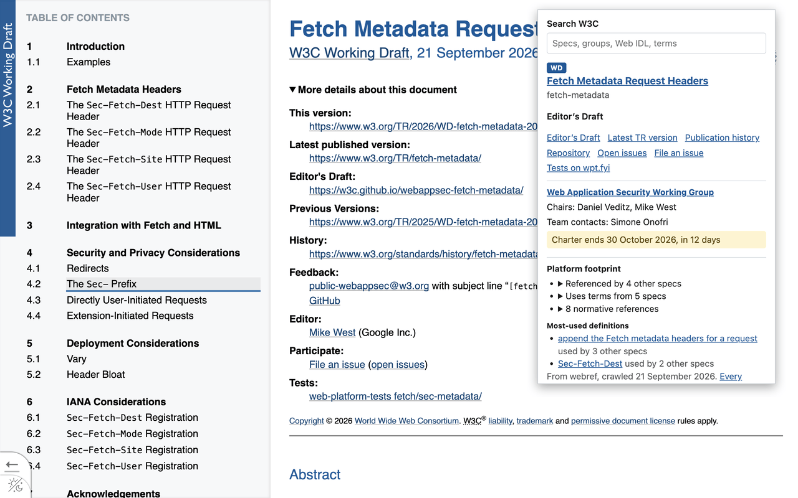
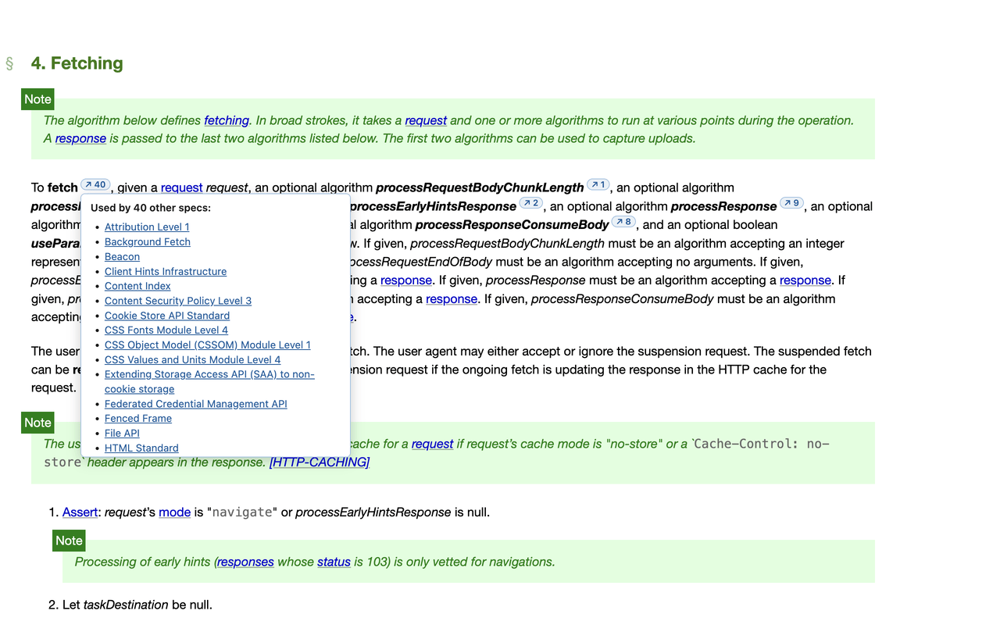
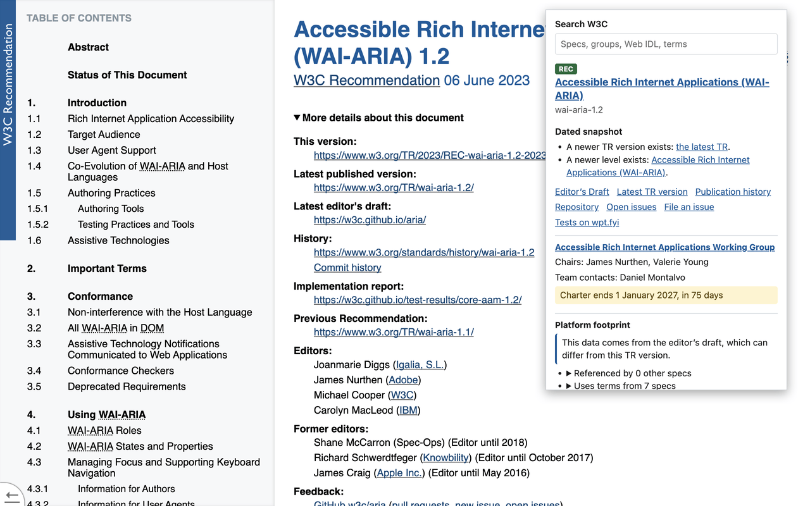

# W3C Companion

A browser extension for reading W3C specs and finding the groups and people behind them. Wherever you are — a spec, a W3C GitHub repo, a w3.org group page — it shows a detailed “cheatsheet” of info for all that’s known about it:

- **The card:** the spec’s maturity, its editor’s draft and TR versions, its repository and issues, its tests, and the group responsible for it — with the group’s chairs, team contacts, and charter end date.
- **The version radar:** whether you’re reading a dated snapshot, whether a newer level exists, and how far the latest TR version lags the draft.
- **Spec intelligence from [webref](https://github.com/w3c/webref):** how many other specs use each definition (what [specdex](https://dontcallmedom.github.io/specdex/) shows, in the page you’re reading), the spec’s platform footprint, and a check of its links to other specs for anchors that no longer exist (one of [strudy](https://github.com/w3c/strudy)’s checks, run live).
- **Search:** type `w3c` and a space in the address bar to search specs, groups, Web IDL names ([webidlpedia](https://dontcallmedom.github.io/webidlpedia/)), and terms (ReSpec’s xref service).
- **TPAC 2026:** what’s in session now and next, and when each group meets.

## Screenshots







More: [a W3C repo on GitHub](screenshots/github-repo.png), [a w3.org group page](screenshots/group-page.png), [the side panel beside a live ReSpec draft](screenshots/side-panel.png), and [TPAC Now and Next on breakout day](screenshots/tpac-now-and-next.png).

## Install

W3C Companion isn’t in the Chrome Web Store or on Firefox Add-ons yet. Until it is, install it from the [latest release](https://github.com/w3c-oss/w3c-companion/releases/latest). It needs Chrome or Edge 148 or later, Firefox 128 or later, or Safari 26 or later.

### Chrome, Edge, and other Chromium-based browsers

1. Download `w3c-companion-<version>.zip` from the latest release, and unzip it into a folder it can stay in — the browser loads the extension from that folder every time it starts.
2. Open `chrome://extensions` (`edge://extensions` in Edge, `brave://extensions` in Brave).
3. Turn on **Developer mode**.
4. Click **Load unpacked**, and select the unzipped folder.

To update it, unzip a newer release into the same folder, and click the reload button on the extension’s card.

### Firefox

1. In Firefox, click `w3c-companion-<version>.xpi` in the latest release, and allow the installation when Firefox asks.
2. Or download the `.xpi`, open `about:addons`, click the gear button, choose **Install Add-on From File…**, and select it.

The `.xpi` is the file Firefox Add-ons signed and serves for that version, so it stays installed after Firefox restarts, and Firefox keeps it up to date from Firefox Add-ons.

### Safari

Safari 26 or later can run W3C Companion as a temporary extension, from the same zip as Chrome. Safari removes a temporary extension when it quits, and after 24 hours, so add it again whenever it’s gone. Safari has no address-bar keywords or side panels for extensions, so the `w3c` keyword and **Keep this open beside the page** aren’t there.

Once, in Safari, choose **Safari** → **Settings…**, select **Advanced**, and turn on **Show features for web developers**. Then, each time:

1. Download `w3c-companion-<version>.zip` from the latest release, if you don’t have it already.
2. In **Safari** → **Settings…**, select **Developer**, click **Add Temporary Extension…**, and select the zip. Authenticate if Safari asks to allow unsigned extensions.
3. Safari shows a warning sign on the extension’s toolbar button until you allow it on a website. Click the button, and allow it on that website or on every website. On every website, the definition counts and the link check work on every spec site the extension knows.

To update it, remove it from the **Temporary** list in **Settings…** → **Extensions**, and add the newer zip.

## Develop

```sh
npm ci
npm run snapshot     # refresh the data bundled in data/
npm run build        # build into dist/
npm test
npm run screenshots  # regenerate screenshots/ (needs Chrome, ImageMagick, and pngquant)
```

Load `dist/` as an unpacked extension (chrome://extensions, Developer mode) or as a temporary add-on in Firefox (about:debugging → This Firefox → Load Temporary Add-on → `dist/manifest.json`).

### Releasing

Bump `version` in `package.json`, commit, and push a matching tag (`v1.0.1` for version 1.0.1). The [Release workflow](.github/workflows/release.yml) then:

- publishes a GitHub release with the zip and the source zip;
- submits the version to Firefox Add-ons, and attaches the signed `.xpi` to the release once Firefox Add-ons approves it — if that takes more than an hour, run the [Attach Firefox build workflow](.github/workflows/attach-firefox-build.yml) later;
- uploads the zip to the Chrome Web Store, and submits it for review.

That needs these repository secrets: `WEB_EXT_API_KEY` and `WEB_EXT_API_SECRET`, from the [Firefox Add-ons API key page](https://addons.mozilla.org/developers/addon/api/key/); and `CWS_EXTENSION_ID`, `CWS_PUBLISHER_ID`, `CWS_CLIENT_ID`, `CWS_CLIENT_SECRET`, and `CWS_REFRESH_TOKEN`, as [chrome-webstore-upload-keys](https://github.com/fregante/chrome-webstore-upload-keys) describes. Without the Chrome Web Store secrets, the Chrome step does nothing, and the version has to be uploaded in the Chrome Web Store developer dashboard.

## Built on the WebExtensions spec

The extension showcases the use of particular features from the [WebExtensions spec](https://w3c.github.io/webextensions/specification/):

| Feature | Spec | What it does here |
|---|---|---|
| Isolated worlds, `world: "MAIN"` | [§3.1](https://w3c.github.io/webextensions/specification/#isolated-worlds), [§13.2](https://w3c.github.io/webextensions/specification/#content-scripts) | A main-world script waits for live ReSpec drafts to render (`document.respec.ready` exists only in the page’s world) |
| Match patterns, `include_globs`, `run_at` | [§9](https://w3c.github.io/webextensions/specification/#match-patterns), [§10](https://w3c.github.io/webextensions/specification/#globs), [§13.2](https://w3c.github.io/webextensions/specification/#content-scripts) | Scripts run only on spec hosts, and on github.com only for the owners of W3C repos (globs generated from the w3c/groups data) |
| Ignoring unknown manifest keys | [§2.2](https://w3c.github.io/webextensions/specification/#manifest-keys) | One manifest declares a side panel and a sidebar, and each browser ignores the key it doesn’t define |
| The `background` key | [§2.2.9](https://w3c.github.io/webextensions/specification/#key-background) ([PR #1123](https://github.com/w3c/webextensions/pull/1123)) | One script serves as a service worker or an event page |
| The `browser` global | [§5](https://w3c.github.io/webextensions/specification/#the-browser-global) | `browser.*` everywhere, with no polyfill |
| `default_locale` and `_locales` | [§2.2.8](https://w3c.github.io/webextensions/specification/#key-default_locale) | Localizable name and description |
| Alarms | [PR #1110](https://github.com/w3c/webextensions/pull/1110) | Scheduled data refreshes |

## Data sources

[browser-specs](https://github.com/w3c/browser-specs), [w3c/groups](https://github.com/w3c/groups),
[webref](https://github.com/w3c/webref), the [W3C API](https://api.w3.org/doc), the
[TPAC 2026 calendar](https://www.w3.org/calendar/tpac2026/), and [ReSpec’s xref service](https://respec.org/xref/).
Snapshots of the spec, group, repository, IDL-name, and TPAC data ship in `data/`, so the extension works offline.

## Privacy

The extension collects nothing and sends nothing about you anywhere. It reads the address of the page you’re on to look it up, and fetches public data from W3C-run services and GitHub Pages. See [store/privacy.md](store/privacy.md).

## Contributing

Contributions are welcome. [CONTRIBUTING.md](CONTRIBUTING.md) covers the contributor license agreement, and [GOVERNANCE.md](GOVERNANCE.md) says how decisions get made. The Project Community is everyone who takes part in this repository’s issues and pull requests.

## License

[Apache-2.0](LICENSE) © 2026 [World Wide Web Consortium](https://www.w3.org/). The W3C symbol in `assets/` and the icons made from it in `static/icons/` are W3C trademarks, which the license doesn’t cover; see the [W3C logo policy](https://www.w3.org/policies/logos/). `npm run icons` renders the icons from the symbol, and needs [ImageMagick](https://imagemagick.org/).
